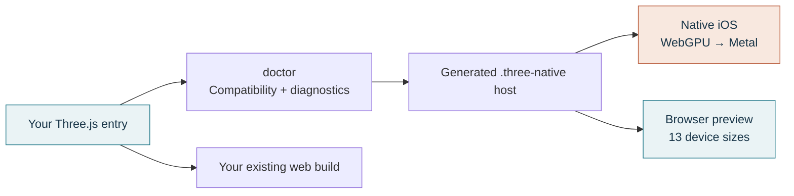
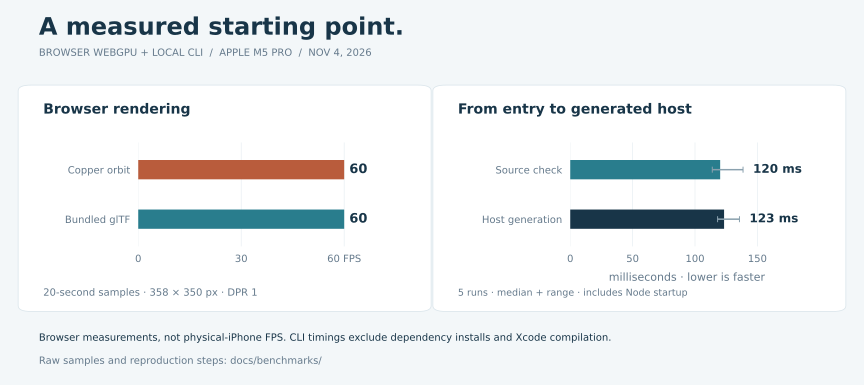

# Three Native


[](https://github.com/jstxn/three-native/actions/workflows/ci.yml) [](#what-works-today) [](LICENSE)

**Keep the scene you built. Add an iOS target.**

Three Native adds a native iOS host to an existing Three.js project. Point a config at your entry file, check compatibility, and run it through React Native WebGPU and Metal. Preview device layouts in the browser, then interact with the actual Simulator or a connected iPhone through the CLI or MCP.

[Get started](#bring-your-project) · [See the measurements](#performance-you-can-inspect) · [Compatibility](#what-works-today) · [API & commands](packages/three-native/README.md)

> **Early alpha.** Install from a local tarball today; npm and Homebrew publishing are pending. Requires Node 22.18+. iOS builds require macOS and Xcode. The native host currently pins Three.js 0.186.0.

## One scene. Two runtimes.


**Left:** a native app in the iPhone 18 Pro Simulator. **Right:** the browser build. Both use the same scene source. This is a 30 fps recording; runtime measurements are below.

| Keep building in Three.js | Get a native development workflow |
| :-- | :-- |
| **Use your existing entry.** Supported renderer setup, frame loops, viewport sizing, and pointer events are adapted automatically. | **Run on iOS.** A generated React Native host renders through WebGPU → Dawn → Metal, with JavaScript running in Hermes. |
| **Keep control of your source.** Generated files live in `.three-native/`; your original entry and browser build stay intact. | **Find blockers early.** `doctor` reports unsupported code with a file, line, and suggested change before a native build starts. |
| **Share scene logic.** Materials, geometry, animation, and interactions can serve both targets. | **Test the actual device.** Use native APIs, Simulator streaming, and physical-iPhone UI automation from the CLI or MCP. |

## Bring your project

Start with a small scene from your existing game or app. The [vanilla example](examples/vanilla) shows an ordinary `WebGLRenderer` entry with animation, resize handling, and pointer input.

<details>
<summary><strong>Build the alpha tarball</strong></summary>

```sh
git clone https://github.com/jstxn/three-native.git
cd three-native
npm ci
mkdir -p artifacts
npm pack ./packages/three-native --pack-destination ./artifacts
```

The package is `artifacts/jstxn-three-native-0.4.0.tgz`. Use its absolute path in your own project below.

</details>

```sh
# Run inside your existing Three.js project.
npm install --save-dev /absolute/path/to/jstxn-three-native-0.4.0.tgz
# Bun works too: bun add --dev /absolute/path/to/the.tgz

npx three-native init --entry ./src/main.js --name "My Game" --bundle-id com.example.mygame
npx three-native doctor
npx three-native dev ios
```

`init` creates a config you can read and edit:

```js
import { defineConfig } from "@jstxn/three-native";

export default defineConfig({
  entry: "./src/main.js",
  name: "My Game",
  ios: { bundleIdentifier: "com.example.mygame" },
  preview: { device: "iphone-18-pro", orientation: "portrait" },
});
```

Only `entry` is required. Try `npx three-native dev web` for the browser preview. `npx three-native build ios` creates a Release **Simulator** app; signed physical development uses `dev ios --device UDID`.



When code needs adaptation, the CLI gives you a place to start:

```text
ERROR TN201 src/hud.js:12:3
  document needs a native adaptation.
  Change: Move this browser-only code to your web entry, or export
  createScene(context) and implement it in the native host.
```

[Automatic adaptation, diagnostics, and the scene-factory escape hatch →](packages/three-native/README.md#point-at-your-existing-entry)

## Preview the target. Test the device.


**13 iPhone and iPad presets.** Select a target, rotate it, and switch between fit and 100% views. The app receives the selected logical viewport; changing the preview scale preserves its aspect ratio. [Sizes and Apple sources →](docs/device-presets.md)

**A live native view, too.** `three-native preview ios --simulator UDID` streams and controls the actual Simulator in a browser. The regular browser preview renders the web build; the stream runs the native app.

**Hardware belongs in the app.** The native API exposes haptics, accelerometer motion, camera capture, and foreground location. The host includes the required modules and permission descriptions. Browser calls report unavailable features; previewing an iPhone does not emulate its hardware.

```js
import { native } from "@jstxn/three-native/native";

if (native.info().environment === "device") {
  await native.haptics.impact("light");
}
```

**Automate a real iPhone.** Inspect the accessibility tree, capture screenshots, tap, swipe, and type through the CLI or the eight `device_ui_*` MCP tools. A trusted phone, Developer Mode, UI Automation, and valid signing are required.

```sh
npx three-native device setup
npx three-native device serve                 # Keep this terminal open.
# In another terminal:
npx three-native device connect --device YOUR_DEVICE_UDID
npx three-native device screenshot --output iphone.png
npx three-native device tap --x 200 --y 400
```

Physical UI control was verified on an iPhone 17 Pro Max using Settings screens. Three.js meshes use coordinate input; native controls can use accessibility IDs. [Physical-device setup and validation →](docs/physical-device-automation.md)

## Performance you can inspect



Measurements from **November 4, 2026**, on an **Apple M5 Pro**. Chromium 156 used the Apple Metal WebGPU adapter at a **358 × 350 drawing buffer, DPR 1**. Each animated scene was sampled for 20 seconds after warmup.

| Browser scene | Median reported FPS | Draw calls | Triangles |
| :-- | --: | --: | --: |
| Copper orbit · PBR + 64 instanced spheres | 60 | 4 | 17,153 |
| Bundled glTF · textured model | 60 | 3 | 939 |

Local `doctor --json` and `prepare` timings include Node startup and use the two-file vanilla example. They exclude dependency installation and Xcode compilation. **These are browser and CLI measurements, not physical-iPhone FPS or an end-to-end build-time promise.** Larger scenes, higher resolutions, device thermals, and third-party code need their own profiling.

[Methodology, raw samples, and reproduction steps →](docs/benchmarks/README.md)

## What works today

| Ready to try | Needs an explicit adaptation | Outside this alpha |
| :-- | :-- | :-- |
| Supported single-renderer browser entries; `requestAnimationFrame` / `setAnimationLoop`; resize and pointer input | DOM/CSS interfaces, keyboard and multitouch controls, custom GLSL, WebGL postprocessing, and unsupported loaders | TestFlight/App Store submission, Android, and general React Three Fiber compatibility |
| An explicit `createScene(context)` API for custom integration | Third-party package internals and browser bundler aliases | A hosted public device cloud |
| Device-size browser previews, native Simulator rendering, CLI/MCP tooling, physical UI automation | Hardware feature behavior and game performance require physical-device validation | A general JavaScript-to-Swift or GLSL-to-Metal compiler |

OrbitControls currently supports single-finger rotation. The browser preview does not reproduce native safe areas, the keyboard, or GPU performance. The [full compatibility guide](packages/three-native/README.md#current-boundaries) explains the current limits.

## Built to be inspected

**41 tests** cover scene behavior, resource disposal, source preservation, compiler diagnostics, CLI safeguards, native API contracts, and device tooling. The [latest measured CI run](https://github.com/jstxn/three-native/actions/runs/41912271975) completed in **1m22s**, including lint, types, Node 24/22.18 tests, the web build, and npm/Bun tarball installs. Linux skips one macOS-specific test.

CI uses one standard Linux job, cached dependencies, a five-minute cap, and cancellation of superseded runs. It does not upload build artifacts. [Contributor setup and checks →](docs/development.md#checks)

Want to help make more projects portable? Try a scene and [report a compatibility issue](https://github.com/jstxn/three-native/issues/new) with a minimal entry, `doctor --json` output, and the target runtime.

- [Package API and CLI reference](packages/three-native/README.md)
- [Run the reference app and contribute](docs/development.md)
- [Device presets](docs/device-presets.md)
- [Native feature and tooling notes](docs/native-device-research.md)
- [Physical iPhone automation](docs/physical-device-automation.md)

MIT licensed. Built on [Three.js](https://threejs.org/), [React Native WebGPU](https://github.com/wcandillon/react-native-webgpu), and [Expo](https://expo.dev/). The bundled [Avocado model](https://github.com/KhronosGroup/glTF-Sample-Assets/tree/main/Models/Avocado) is by Microsoft, CC0; [attribution](assets/models/Avocado-source.md) is retained.
