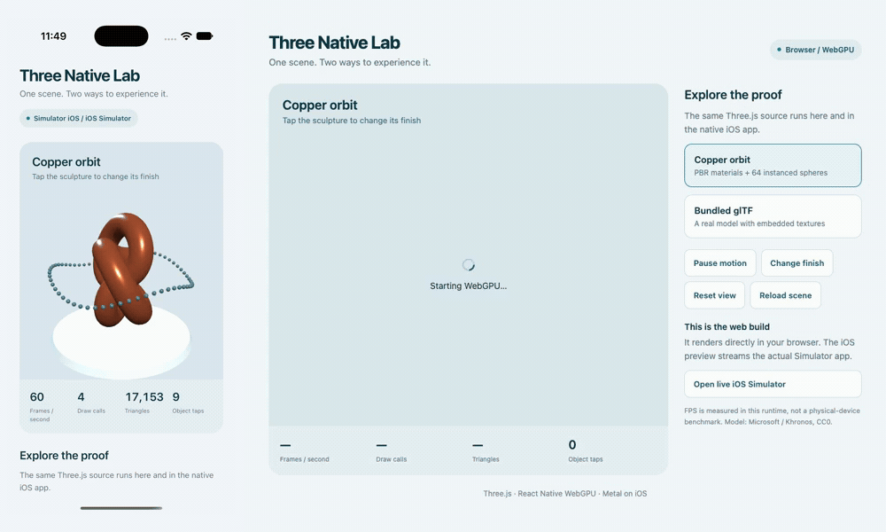

# Three Native

An installable CLI and runtime that add a native iOS target to an existing Three.js project. The package lives in `packages/three-native/`; `examples/vanilla/` is an existing Vite + Three.js consumer. The root app is the visual native/browser reference demo.

## See it running



**Left:** the native iOS app in an iPhone 18 Pro Simulator. **Right:** the same Three.js scene rendered directly in the browser. The 30 fps GIF shows live animation and material changes from user input in both runtimes.

## Try the installable package

```sh
git clone https://github.com/jstxn/three-native.git
cd three-native
npm ci
mkdir -p artifacts
npm pack ./packages/three-native --pack-destination ./artifacts
# From your existing Three.js project:
npm install --save-dev /absolute/path/to/jstxn-three-native-0.2.0.tgz
# Bun can install the same tarball with: bun add --dev /absolute/path/to/the.tgz
npx three-native init --entry ./src/main.js --name "My App" --bundle-id com.example.myapp
npx three-native doctor
npx three-native dev ios
npx three-native build ios
npx three-native preview ios --simulator <UDID>
```

The CLI creates `three-native.config.mjs` and builds in `.three-native/`; it leaves the existing browser entry and package configuration intact. Point it at an ordinary browser entry: supported renderer setup, animation loops, viewport sizing, and pointer input are adapted automatically. `doctor` parses the entry and local imports and reports required changes with file/line locations; blocking issues stop generation and builds. An explicit `createScene(context)` factory remains available for custom integrations. See [the package README](packages/three-native/README.md) for the complete API and commands.

The npm package and Homebrew formula are prepared locally, **not published**. npm and Bun installation checks use the real packed tarball. The Homebrew recipe in `packaging/homebrew/` needs the published release URL before distribution.

## Reference demo

A standalone proof of concept: the same Three.js scene runs in a native iOS app and directly in a browser. A separate local browser page streams and controls the actual iOS Simulator app.

## Run locally

```sh
npm ci
cp .env.example .env.local
npm run ios -- --configuration Release
```

Select an iOS Simulator when prompted. The release app bundles its JavaScript and CC0 glTF asset; it does not require Metro to run.

Start the interactive simulator stream in a separate terminal, using its exact UDID from `xcrun simctl list devices available`:

```sh
npm run preview:ios -- <simulator-udid>
```

Keep that terminal open. The preview uses loopback port 8087 and a simulator-specific cleanup trap. Stopping it cleans up its streaming helper. It does not expose a host shell or open a public tunnel.

Build and serve the browser version:

```sh
npm run build:web -- --max-workers 2
python3 -m http.server 8086 --bind 127.0.0.1 --directory dist
```

Open http://127.0.0.1:8086. **Open live iOS Simulator** opens the stream at http://127.0.0.1:8087. The two views are labeled separately: one executes the web build; the other streams a native app. `.env.local` supplies the local preview link and is not committed. Omit that variable for a web-only deployment.

The browser must support WebGPU. This proof reports an error instead of silently switching to WebGL.

## What to try

- Copper orbit: a Three.js PBR material and 64 GPU-instanced spheres.
- Bundled glTF: a textured avocado loaded from a self-contained GLB.
- Tap the object, change its finish, pause/resume, and reset the view.
- Reload the scene repeatedly; rotate the simulator; send it to the home screen and reopen it.
- Compare the actual native stream with the browser build, without treating simulator FPS as physical-device performance.

## Code

- `src/lib/proof-scene.ts`: shared scene construction, picking, updates, and resource disposal. No React Native imports.
- `packages/three-native/lib/analyze.mjs`: source analysis, actionable diagnostics, and generated browser-entry adapters.
- `packages/three-native/runtime/BrowserEntry.mjs`: native clock, renderer, viewport, and pointer bridge.
- `packages/three-native/runtime/ThreeView.tsx`: the reusable canvas, asset resolver, presentation, resizing, and app lifecycle.
- `src/components/proof-canvas.tsx`: adapts the reference scenes to the same public runtime.
- `src/app/index.tsx`: shared native/web controls and runtime measurements.
- `scripts/preview-ios.sh`: simulator streaming through pinned `serve-sim`.

The native pipeline is Three.js WebGPURenderer → React Native WebGPU → Dawn → Metal. JavaScript runs in Hermes; this is not JavaScript-to-Swift compilation. The browser uses the same renderer and scene through its own WebGPU implementation.

The project began with the [upstream Expo WebGPU template](https://github.com/wcandillon/react-native-webgpu/tree/main/apps/expo-webgpu), simplified to plain Three.js and updated to the pinned WebGPU/Three versions in `package-lock.json`. Native project files are generated from `app.config.js`; do not edit them by hand.

## Checks

```sh
npm test
npm run typecheck
npm run lint
npm run doctor
npm run check:package
```

The Node suite checks scene geometry, picking, resource disposal, CLI overwrite protections, browser-entry execution, animation/resize/input adaptation, OrbitControls, imported-file diagnostics, and source preservation. It does not substitute for GPU rendering checks on iOS and the browser.

## Verified locally on 2026-11-04

- Node 24.15.0, Expo 57.0.31, React Native 0.86.3, Three.js 0.186.0, React Native WebGPU 0.21.1.
- Xcode 27.2, iPhone 18 Pro Simulator with iOS 27.2, Release builds.
- Twenty scene/compiler/CLI tests, lint, type checking, and Expo Doctor (21/21 checks on the original native stack).
- Real tarball installation through both npm and Bun; config and host generation preserve the existing source.
- Both the reference app and the CLI-generated vanilla app build and render natively. The vanilla config now points directly to its existing `src/main.js` browser entry, including WebGLRenderer, DOM mounting, a render loop, and pointer input; no manual scene-factory adaptation is required.
- Reference GLB rendering, three model reloads, native scene changes from browser input, and background/resume through the browser's Home control.
- Browser WebGPU export, model loading, pause/finish controls, narrow layout, and a final run with no browser console errors.

The initial native checks caught two version/configuration requirements now owned by the toolkit: Expo's scene lifecycle opt-in for iOS 27, and Three r186 rather than r187 on this Hermes runtime. GLB samples parse fetched bytes directly to avoid the native `FileLoader` progress-stream incompatibility.

## Boundaries

This is a local demonstration, not a public device cloud. Public interactive simulator sessions need a hosted Mac, authentication, session isolation, and streaming capacity. A simulator stream is not a physical iPhone stream. Physical-device performance, signing/distribution, Android, arbitrary third-party Three plugins, and App Store acceptance are not established by this proof.

The [Avocado model](https://github.com/KhronosGroup/glTF-Sample-Assets/tree/main/Models/Avocado) is by Microsoft, distributed under CC0. Its source attribution is retained in `assets/models/Avocado-source.md`.
