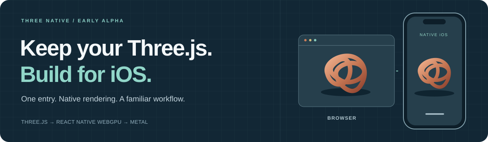
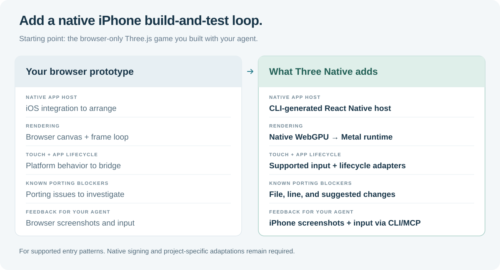
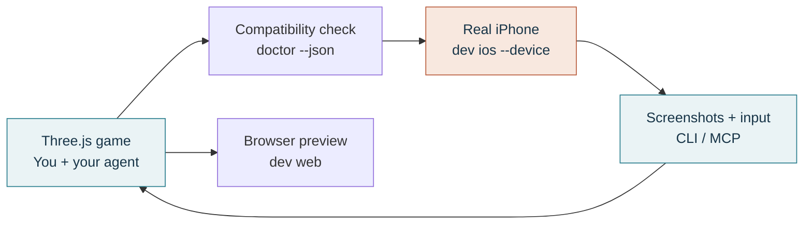
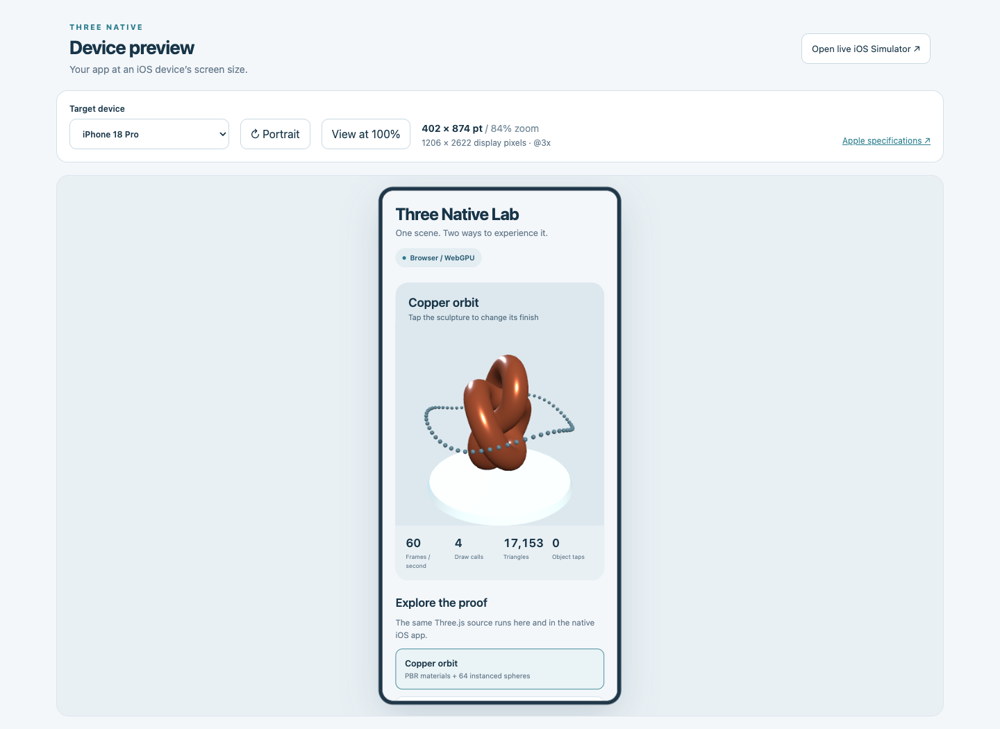

# Three Native



[](https://github.com/jstxn/three-native/actions/workflows/ci.yml) [](#what-works-today) [](LICENSE)

**Your agent helped build the game. Now playtest it on your iPhone.**

If you are building a Three.js game with a coding agent, Three Native helps you carry that project into a native iOS development workflow. Point a config at your existing entry, check compatibility, and build for a connected iPhone. Use CLI and MCP tools to inspect the running app, send input, and bring observations back into the next iteration with your agent.

The game stays in JavaScript. Its native graphics surface renders through React Native WebGPU → Dawn → Metal. Your existing browser build remains available for fast iteration.

[Agent-to-iPhone workflow](#from-agent-built-game-to-iphone) · [What it adds](#what-three-native-adds) · [Compatibility](#what-works-today) · [API & commands](packages/three-native/README.md)

> **Early alpha.** Install from a local tarball; npm and Homebrew publishing are pending. Requires Node 22.18+. iPhone development requires macOS, Xcode, device trust, Developer Mode, and valid signing. The native host pins Three.js 0.186.0.

## Keep the browser loop. Add native testing.


**Left:** a native app in the iPhone 18 Pro **Simulator**. **Right:** the browser build. Both use the same scene source. This 30 fps recording demonstrates the two runtimes; it is not physical-iPhone footage or a device-performance benchmark.

## What Three Native adds



The improvement is the path from a browser prototype to an iPhone development and testing loop. Three Native supplies the host, supported adapters, and project-aware tools you would otherwise integrate around your game. It does not require you to move your scene into a new game engine.

In the included [vanilla example](examples/vanilla), both original game files stay unchanged while the CLI generates the native host. Rendering has been verified in the browser and iOS Simulator; physical-device validation is described below.

## From agent-built game to iPhone

The [vanilla example](examples/vanilla) starts from an ordinary `WebGLRenderer` entry with animation, resize handling, and pointer input. Start with a small playable slice of your game and expand as its compatibility checks pass.



### 1. Build or adapt the game with your agent

An example starting brief:

```text
Build a small Three.js game with its entry at src/main.js.
Use one renderer and pointer input. Keep shared game logic separate
from browser-only DOM UI. After adding three-native, run doctor --json
and use its diagnostics to identify the changes needed for iOS.
```

Three Native adapts supported startup patterns. DOM interfaces, keyboard controls, custom shaders, and some dependencies need explicit changes; a successful source check still needs runtime testing. [Compatibility and the scene-factory escape hatch →](packages/three-native/README.md#point-at-your-existing-entry)

### 2. Add Three Native to the existing project

<details>
<summary><strong>Build the alpha tarball</strong></summary>

```sh
git clone https://github.com/jstxn/three-native.git
cd three-native
npm ci
mkdir -p artifacts
npm pack ./packages/three-native --pack-destination ./artifacts
```

The package is `artifacts/jstxn-three-native-0.4.0.tgz`. Use its absolute path in your game project below.

</details>

```sh
# Run inside your existing Three.js game project.
npm install --save-dev /absolute/path/to/jstxn-three-native-0.4.0.tgz
# Bun works too: bun add --dev /absolute/path/to/the.tgz

npx three-native init --entry ./src/main.js --name "My Game" --bundle-id com.example.mygame
npx three-native doctor --json
```

The JSON report lets an agent inspect errors without scraping terminal prose. Blocking diagnostics stop native generation and builds. For example:

```text
ERROR TN201 src/hud.js:12:3
  document needs a native adaptation.
  Change: Move this browser-only code to your web entry, or export
  createScene(context) and implement it in the native host.
```

### 3. Build and run on your iPhone

Connect and unlock the phone, trust the Mac, enable Developer Mode, and set up your Apple development team in Xcode. Add its 10-character team ID to `three-native.config.mjs`:

```js
import { defineConfig } from "@jstxn/three-native";

export default defineConfig({
  entry: "./src/main.js",
  name: "My Game",
  ios: {
    bundleIdentifier: "com.example.mygame",
    appleTeamId: "YOURTEAMID",
  },
  preview: { device: "iphone-18-pro", orientation: "portrait" },
});
```

```sh
npx three-native devices
npx three-native dev ios --device YOUR_DEVICE_UDID
```

Use the physical device's UDID from `devices`. The CLI generates the host and builds/runs a signed development app; keep the development process running while you iterate. Signing credentials and device trust must already be valid.

For a Simulator instead, use `dev ios --simulator YOUR_SIMULATOR_UDID`. The separate `build ios` command creates a Release **Simulator** app; it is not the physical-device deployment command or an App Store submission pipeline.

### 4. Let your agent inspect, interact, and help retest

After generating the native project, install the local UI automation tools once:

```sh
npx three-native device setup
```

Enable **Settings → Developer → Enable UI Automation** on the iPhone. WebDriverAgent also needs valid signing; its first connection can take several minutes. [Physical-device setup →](packages/three-native/README.md#control-a-physical-iphone)

Configure an MCP-capable client to launch `three-native mcp` for this project and phone. It exposes Xcode build/launch tools alongside `device_ui_connect`, `device_ui_snapshot`, `device_ui_screenshot`, `device_ui_tap`, `device_ui_swipe`, `device_ui_type`, and session-management tools.

<details>
<summary><strong>Example MCP client configuration</strong></summary>

For clients that use an `mcpServers` object; other clients can use the same command and arguments in their own configuration format:

```json
{
  "mcpServers": {
    "three-native": {
      "command": "/absolute/path/to/game/node_modules/.bin/three-native",
      "args": [
        "mcp", "--project", "/absolute/path/to/game",
        "--device", "YOUR_DEVICE_UDID"
      ]
    }
  }
}
```

The MCP connection starts its local automation service when needed. No separate `device serve` terminal is required for that connection.

</details>

An example test brief for your agent:

```text
Connect to the configured iPhone and capture the game's screen.
Inspect the screen bounds, test the start control and one gameplay
interaction, and capture the result. Report what you observed.
Reproduce a problem before changing code, then rebuild and retest
that interaction after the change.
```

Native controls can use accessibility IDs. Three.js meshes use coordinate input in screen points; they do not automatically appear as native accessibility nodes. These tools provide interaction and evidence, not an automatic judgment that gameplay is correct. Permission prompts remain visible for the developer to handle.

<details>
<summary><strong>Prefer to test through the CLI?</strong></summary>

```sh
npx three-native device serve                 # Keep this terminal open.
# In another terminal:
npx three-native device connect --device YOUR_DEVICE_UDID
npx three-native device snapshot
npx three-native device screenshot --output iphone.png
npx three-native device tap --x 200 --y 400
npx three-native device disconnect
```

[All CLI and MCP commands →](packages/three-native/README.md#commands)

</details>

**Verification today:** reference scenes render on iOS Simulator. Physical UI automation was exercised on an iPhone 17 Pro Max using Settings screens. A signed Three.js game on physical hardware and physical-iPhone performance remain unverified in this proof. [Validation details →](docs/physical-device-automation.md#repository-validation-on-2026-11-04)

## Keep fast browser feedback



Run `npx three-native dev web` between device runs. Choose among **13 iPhone and iPad presets**, rotate the viewport, and switch between fit and 100% views. These are layout checks; the browser preview does not reproduce native safe areas, hardware, or device GPU performance. [Sizes and Apple sources →](docs/device-presets.md)

For a browser view of the actual native Simulator, use `three-native preview ios --simulator UDID`. That stream and the ordinary web build are separate views.

The native API also exposes haptics, accelerometer motion, camera capture, and foreground location. The host includes the required modules and permission descriptions. Browser calls report unavailable features; test hardware behavior in the signed app.

```js
import { native } from "@jstxn/three-native/native";

if (native.info().environment === "device") {
  await native.haptics.impact("light");
}
```

<details>
<summary><strong>Engineering baselines and measurement limits</strong></summary>

The two small reference scenes reported 60 FPS in 20-second browser samples on an Apple M5 Pro at a 358 × 350 drawing buffer. These establish that the examples run; they do not establish a speedup over another approach or predict iPhone performance.

The local CLI timing samples measure source analysis and host generation, excluding dependency installation and Xcode compilation. They are not end-to-end build times.

[Baseline charts, raw samples, and reproduction steps →](docs/benchmarks/README.md)

</details>

## What works today

| Ready to try | Needs an explicit adaptation | Outside this alpha |
| :-- | :-- | :-- |
| Supported single-renderer browser entries; `requestAnimationFrame` / `setAnimationLoop`; resize and pointer input | DOM/CSS interfaces, keyboard and multitouch controls, custom GLSL, WebGL postprocessing, and unsupported loaders | TestFlight/App Store submission, Android, and general React Three Fiber compatibility |
| An explicit `createScene(context)` API for custom integration | Third-party package internals and browser bundler aliases | A hosted public device cloud |
| Device-size browser previews, native Simulator rendering, CLI/MCP tooling, physical UI automation | Hardware feature behavior and game performance require physical-device validation | A general JavaScript-to-Swift or GLSL-to-Metal compiler |

OrbitControls currently supports single-finger rotation. The browser preview does not reproduce native safe areas, the keyboard, or GPU performance. The [full compatibility guide](packages/three-native/README.md#current-boundaries) explains the current limits.

## Built to be inspected

**41 tests** cover scene behavior, resource disposal, source preservation, compiler diagnostics, CLI safeguards, native API contracts, and device tooling. The [reference CI run](https://github.com/jstxn/three-native/actions/runs/41912271975) completed in **1m22s**, including lint, types, Node 24/22.18 tests, the web build, and npm/Bun tarball installs. Linux skips one macOS-specific test.

CI uses one standard Linux job, cached dependencies, a five-minute cap, and cancellation of superseded runs. It does not upload build artifacts. [Contributor setup and checks →](docs/development.md#checks)

Want to help make more projects portable? Try a scene and [report a compatibility issue](https://github.com/jstxn/three-native/issues/new) with a minimal entry, `doctor --json` output, and the target runtime.

- [Package API and CLI reference](packages/three-native/README.md)
- [Run the reference app and contribute](docs/development.md)
- [Device presets](docs/device-presets.md)
- [Native feature and tooling notes](docs/native-device-research.md)
- [Physical iPhone automation](docs/physical-device-automation.md)

MIT licensed. Built on [Three.js](https://threejs.org/), [React Native WebGPU](https://github.com/wcandillon/react-native-webgpu), and [Expo](https://expo.dev/). The bundled [Avocado model](https://github.com/KhronosGroup/glTF-Sample-Assets/tree/main/Models/Avocado) is by Microsoft, CC0; [attribution](assets/models/Avocado-source.md) is retained.
